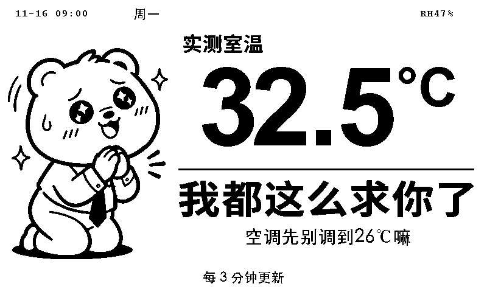

# 小熊温度牌 · Desk Thermometer

一块会按星期换小熊、按实测室温决定是否开口请求的墨水屏温度牌。

**当前版本 v1.5.2。** 使用微雪ESP32-S3-ePaper-3.97一体板；当前固件是确定性规则，不调用大模型，也不控制空调。



## 已有功能

- 800×480墨水屏显示大号室温、湿度、北京时间、星期。
- 周一到周五五款小熊，周末沿用周五，顶部仍显示真实星期。
- **实测≥25.5℃：**当天标题＋“空调先别调到26℃嘛”。**实测<25.5℃：**标题与副句全部隐藏，保留小熊与数据。
- 睡眠180秒后重新采样刷新；短按BOOT唤醒刷新。
- 长按BOOT进入手机配网；自动扫描2.4GHz Wi-Fi，点选名称后输入密码。隐藏网络可手填。
- 临时热点每次生成8位数字密码；配网中短按BOOT松手、网页返回或5分钟超时均可退出。
- 保存一个网络，限频联网校时；网络校时受限时可使用手机时间。
- 传感器错误、时钟无效、屏幕超时均有处理路径。

## 功能原型和设计

- [功能原型与状态机](docs/功能原型与状态机.md)：一周内容表、温度边界、两张Mermaid状态图、验收边界。
- [交互原型HTML](docs/功能原型.html)：下载仓库后用浏览器打开，选择星期和示例温度。GitHub网页显示源代码，不是在线应用。
- [玩法路线图](docs/玩法路线图.md)：节日彩蛋、手机留言、专注计时、天气、温湿度日记等，**尚未实现**。
- [构建与使用](docs/构建与使用.md)。

图片为实际C++绘图代码的主机渲染，不是实机照片。原始AI辅助生成的小熊插画包含历史示例文字，固件会清除这些区域后绘制实时数据和新文案。

## 快速构建

需要Arduino CLI。安装ESP32平台源后：

```sh
arduino-cli core update-index --additional-urls https://espressif.github.io/arduino-esp32/package_esp32_index.json
arduino-cli core install esp32:esp32@3.3.12 --additional-urls https://espressif.github.io/arduino-esp32/package_esp32_index.json
arduino-cli lib install SensorLib@0.3.1
arduino-cli compile --build-path work/build --fqbn esp32:esp32:esp32s3:CDCOnBoot=cdc,FlashSize=16M,PartitionScheme=app3M_fat9M_16MB,PSRAM=opi src/desk_thermometer
```

仓库已含生成后的点阵头文件，**仅编译固件无需Python或macOS字体**。修改中文文案/插画后才需要重新生成；现有生成脚本使用macOS字体路径，其他系统需自行替换有权使用的字体。Arduino跨平台构建路径尚未在Windows/Linux机器实测。

## 验收情况与限制

实机已确认：画面、Wi-Fi扫描点选、保存网络、联网校时、日期恢复、8位热点密码、短按退出、小数点清晰。重启重连、显示成功与180秒睡眠有设备日志证据。另有38项故障回归、1826天日期对照、40张实际C++渲染，以及网络策略/RTC写入/按键测试。

尚未测量或完整验收：满电续航、参考温度计校准、装壳后偏差、长期无网保时、所有公司网络兼容、实际低温环境分支。阈值用原始平均值，25.49℃显示25.5℃但不显示请求。配网常亮、充电和电脑热源可能影响当前读数，应静置后观察。裸板不要直接贴墙或挤压电池。

本项目只提供友好请求，不代表所有人的舒适温度；实际空气温度不等于空调设定温度。

## 目录

| 路径 | 内容 |
|---|---|
| src/desk_thermometer | 固件、驱动、生成点阵 |
| src/tools | 点阵生成和不主动切DTR/RTS的串口采集 |
| src/tests | 主机回归和实际绘图检查 |
| config/messages.json | 文案、阈值、频率；states为旧三档兼容项 |
| docs | 功能说明、原型、构建、玩法 |
| out/工作日五款_2026-11-14 | 五款插画源素材 |

仅包含可复刻的源码和演示资产，不包含Wi-Fi凭证、整片Flash备份、私人照片、原始串口日志或个人项目历史。

## 来源与许可

基于[微雪官方示例](https://github.com/waveshareteam/ESP32-S3-ePaper-3.97)及[SensorLib](https://github.com/lewisxhe/SensorsLib)。第三方版权声明保留在原文件中，见[第三方来源](THIRD_PARTY_NOTICES.md)。本项目新增代码采用MIT许可。
