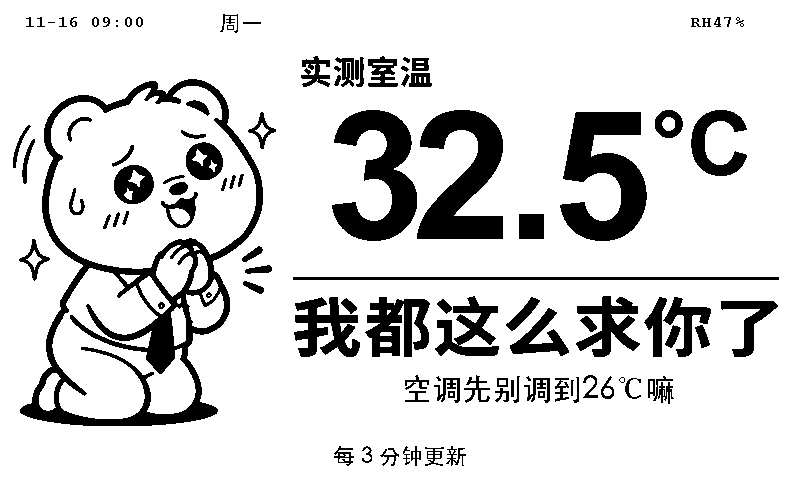
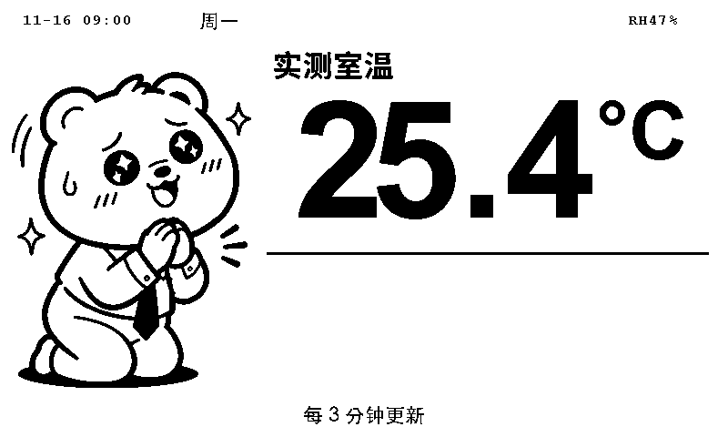
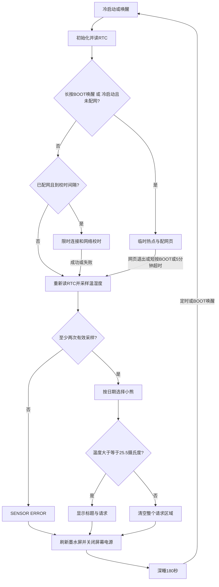
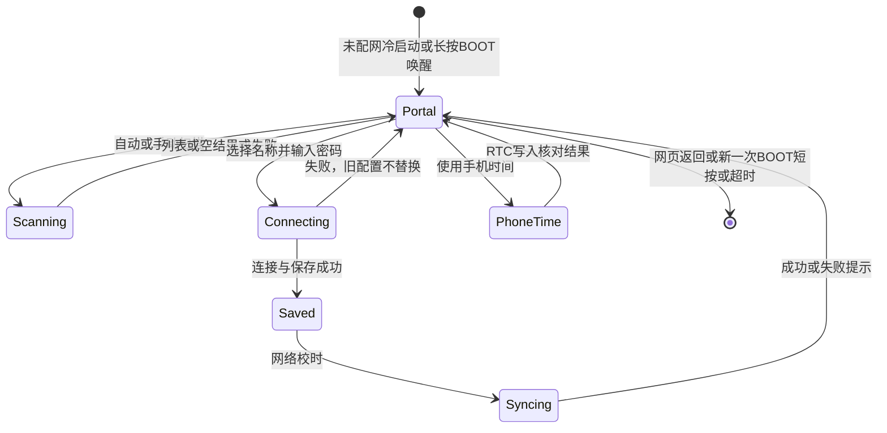

# 功能原型与状态机

适用固件：v1.5.2。依据实际代码整理。当前是确定性规则温度牌，没有调用大模型；它不控制空调，也不知道遥控器设定或谁在操作。

[交互原型](功能原型.html)：下载仓库后用浏览器打开，可选星期和示例温度。图片由实际C++绘图代码在电脑上渲染，**不是实机照片**。

## 温度决定说不说，星期决定用哪张图

| 条件 | 请求区域 | 保留内容 |
|---|---|---|
| 实测温度≥25.5℃，包含25.5，无上限 | 星期标题＋「空调先别调到26℃嘛」 | 小熊、温湿度、日期时间、星期、更新频率 |
| 实测温度<25.5℃ | 整个标题和副句置空，不建议调高或调低 | 小熊、温湿度、日期时间、星期、更新频率 |
| 传感器采样无效 | SENSOR ERROR，不提供调温请求 | 时间状态；下一轮重试 |

三次采样至少两次有效，取有效值平均。阈值用舍入前实测值，没有回滞：**25.49℃显示为25.5℃，但请求仍隐藏**。显示精度不等于已校准准确度。

## 每天展示什么

下表标题仅在≥25.5℃时出现，副句统一为「空调先别调到26℃嘛」。插画源文件的旧副句和页脚由固件覆盖，不能用原图代替最终渲染。

| 星期 | 形象 | 标题 |
|---|---|---|
| 周一 | 跪地恳求 | 我都这么求你了 |
| 周二 | 合掌请求 | 给我留口凉气吧 |
| 周三 | 抱冰块 | 人可以上头 |
| 周四 | 趴着吹风 | 再热就要掉线了 |
| 周五 | 鞠躬感谢 | 本周最后一跪 |
| 周六、周日 | 沿用周五形象 | 本周最后一跪 |

星期从年月日计算，周末顶部仍显示真实星期。时钟无效时显示TIME UNSET、隐藏星期标签、回退周一形象；温度规则继续。

## 主状态机

帧缓冲分配失败直接睡眠；供电或BUSY错误放弃本轮刷新，下轮重试。断电后墨水屏保留旧图，有画面不证明设备正在运行。

## 配网状态机

- 每次开启热点生成新的8位数字密码。访问 http://192.168.4.1；配置服务只绑定临时热点接口。
- 扫描2.4GHz网络，同名合并、最多32项，按信号强弱显示；隐藏网络可手填。
- 只保存一个普通密码网络，成功保存新网络后替换旧配置；不支持网页登录、企业账号认证。
- 连接最长约15秒，NTP最长约12秒；失败可用手机时间。网络操作中按键可能等请求结束后才处理。
- 5分钟超时从设置画面显示完成计时，不因操作续期。退出方式：网页返回、短按BOOT并松手、超时。
- 进入时的长按松手不算退出，需要再按一次；40ms防抖。上电时按住BOOT可能进下载模式。
- 密码仅存本地NVS，目前未启用NVS加密；不要上传整片Flash备份。

## 时间和刷新

| 项目 | 当前行为 |
|---|---|
| RTC | PCF85063存北京时间；网络时间按UTC转北京时间 |
| 校时频率 | 首次符合条件时尝试；之后有效时钟约480次唤醒，无效约20次唤醒重试 |
| 频率含义 | 纯定时约24小时/1小时，按键唤醒也计数；复位后计数可能重置 |
| 离开保存的网络 | 不自动反复开热点，继续测温 |
| 更新间隔 | 睡眠180秒，实际画面间隔还包括唤醒/刷新耗时 |
| 屏幕刷新 | 冷启动及刷新计数每24次完整刷新，其余快速刷新；闪黑是刷新过程 |
| 普通短按BOOT | 深睡中唤醒刷新；配网页中退出 |

## 验收边界

已获实机确认：正常画面、扫描点选、连接保存与网络校时、恢复日期、8位密码、短按退出、小数点留白。串口证明重启后可重连保存的网络，刷新成功并睡眠180秒。阈值、日期和异常路径有主机测试。

尚未验证：参考温度计校准、满电续航、装壳后的温度偏差、当前版长期无网保时、所有公司网络兼容、真实环境低温分支。烧录重启曾出现RTC停振标志，有网能恢复；不承诺完全断电保时。

源码：`desk_thermometer.ino`的drawScreen/setup/goToSleep，及weekday_theme.h、network_setup.cpp、network_policy.h、portal_button.h。旧classify三档仍用于日志与变化判断，**不再决定请求文案**。
